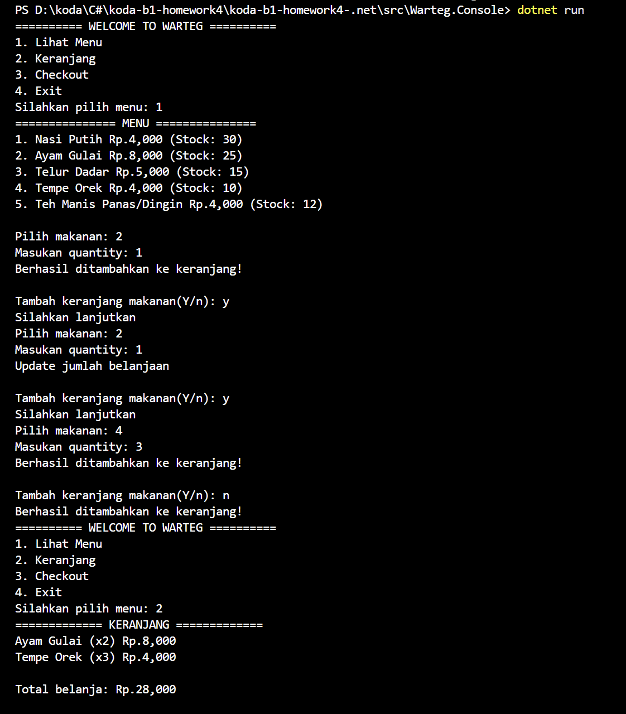
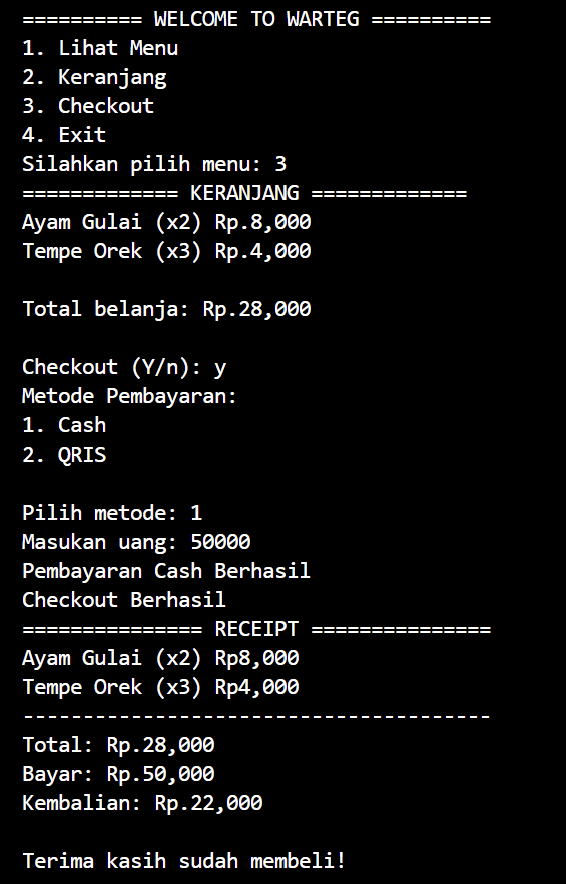

# Warteg Console Application

## Fitur Utama

- Lihat Menu
- Keranjang
- Checkout (Cash or Qris)
---

## Struktur Class dan Arsitektur


### Penjelasan Masing-Masing Class

| Layer / Kategori | Nama Class / Interface | Deskripsi & Peran |
| :--- | :--- | :--- |
| **Interface** | `IPaymentable` | Mendefinisikan kontrak method wajib bagi setiap sistem pembayaran (`Pay`, `PaymentName`, `NominalPay`, `Kembalian`). |
| **Model (Abstraksi)** | `Payment` | Kelas abstrak (*abstract base class*) yang mengimplementasikan `IPaymentable`. Menjadi cetak biru bagi metode pembayaran turunan. |
| **Model (Konkrit)** | `CashPayment` | Turunan dari `Payment` untuk transaksi tunai. Memvalidasi nominal uang pembeli dan menghitung sisa kembalian. |
| **Model (Konkrit)** | `QrisPayment` | Turunan dari `Payment` untuk transaksi QRIS digital. Mengonfirmasi pembayaran instan (kembalian bernilai 0). |
| **Model (Base)** | `Menu` | Entitas dasar item warteg yang menyimpan informasi nama, harga, dan stok, serta enkapsulasi manipulasi stok (`ReduceStock`, `AddStock`). |
| **Model (Turunan)** | `Category` | Pewarisan dari `Menu` yang menambahkan metadata kategori (seperti *"Makanan"* atau *"Minuman"*). |
| **Model** | `Cart` | Merepresentasikan baris item dalam keranjang belanja, menampung referensi objek `Menu` dan jumlah kuantitas (`Quantity`) yang dipesan. |
| **Service** | `MenuServices` | Layanan statis untuk mengisi data menu default warteg dan menampilkannya dalam format bernomor di layar konsol. |
| **Service** | `CartServices` | Layanan bisnis untuk mengelola keranjang: menambahkan pesanan baru, menggabungkan item yang sama, dan menampilkan ringkasan belanjaan beserta total harga. |
| **Service** | `CheckoutServices` | Layanan proses transaksi checkout: memilih metode pembayaran, memproses pemotongan stok barang, dan mencetak struk belanja resmi (*Receipt*). |
| **Program** | `Program.cs` | Titik awal eksekusi program (*entry point*), mengatur navigasi menu utama menggunakan perulangan `while` dan struktur kontrol `switch-case`. |

---

## Penerapan Konsep OOP

### 1. Encapsulation (Enkapsulasi)(*access modifier*).
- **Pembatasan Properti**:
  Pada kelas `Menu.cs`, properti `Price` dan `Stock` menggunakan accessor `private set`:
  ```csharp
  public decimal Price { get; private set; } = price;
  public int Stock { get; private set; } = stock;
  ```
  mencegah nilai stok diubah sembarangan dari luar kelas.
- **Validasi Mutasi Data**:
  Pengurangan stok hanya diizinkan melalui method `ReduceStock(int quantity)` yang memvalidasi bahwa stok cukup dan kuantitas valid:
  ```csharp
  public void ReduceStock(int quantity)
  {
      if(Stock <= 0 || quantity < 0)
      {
          throw new ArgumentException("Stok not valid");
      }
      Stock -= quantity;
  }
  ```
- **Proteksi Nilai Transaksi**:
  Pada `CashPayment` dan `QrisPayment`, properti `Nominal` dan `Change` juga berstatus `private set`, sehingga hanya dapat diubah oleh logika internal method `Pay()`.

### 2. Inheritance (Pewarisan)
- **`Category` mewarisi `Menu`**:
  `Category` mewarisi seluruh kemampuan `Menu` (nama, harga, stok, validasi stok) sekaligus memperluas fungsinya dengan atribut kategori:
  ```csharp
  public class Category(string name, decimal price, int stock, string categoryName) 
      : Menu(name, price, stock)
  {
      public string CategoryName { get; set; } = categoryName;
  }
  ```
- **`CashPayment` dan `QrisPayment` mewarisi `Payment`**:
  Kedua metode pembayaran mewarisi struktur kelas dasar `Payment`.

### 3. Polymorphism (Polimorfisme)
- **Polymorphism (Method Overriding)**:
  `CashPayment` dan `QrisPayment` meng-override method abstrak `Pay(decimal total)` dengan implementasi spesifik:
  - `CashPayment.Pay()` meminta uang tunai, memeriksa `Nominal < total`, dan menghitung kembalian.
  - `QrisPayment.Pay()` menampilkan simulasi scan QRIS dan meminta konfirmasi `(Y/n)` tanpa adanya uang kembalian.
- **Polymorphic Reference**:
  Pada `CheckoutServices.cs`, pemanggilan pembayaran dilakukan secara polimorfik melalui tipe referensi dasar `Payment`:
  ```csharp
  Payment payment;
  switch (metode)
  {
      case 1:
          payment = new CashPayment();
          break;
      case 2:
          payment = new QrisPayment();
          break;
      default:
          return;
  }

  bool success = payment.Pay(total);
  ```
  Method `Receipt(..., Payment payment)` dapat menerima objek `CashPayment` maupun `QrisPayment` tanpa perlu membedakan logikanya.

### 4. Abstraction (Abstraksi)
Abstraksi berfokus pada penyediaan antarmuka tanpa mengekspos detail implementasi yang rumit kepada pengguna modul.
- **Interface `IPaymentable`**:
  Mendefinisikan kontrak mutlak bahwa setiap mekanisme pembayaran wajib memiliki method `Pay`, `PaymentName`, `NominalPay`, dan `Kembalian`.
  ```csharp
  public interface IPaymentable
  {
      bool Pay(decimal total);
      string PaymentName();
      decimal NominalPay();
      decimal Kembalian();
  }
  ```
- **Abstract Class `Payment`**:
  Berperan sebagai kelas perantara yang mendefinisikan kerangka pembayaran yang mengikat secara kontrak terhadap `IPaymentable`.

### 5. Association & Data Integrity
- **Hubungan Asosiasi/Komposisi**: Class `Cart` memiliki relasi `has-a` terhadap `Menu` (`public Menu Menus`), merepresentasikan item menu yang dipilih pelanggan.
- **LINQ & Functional Query**: `CartServices` dan `CheckoutServices` memanfaatkan fitur LINQ C# (`Sum`, `FirstOrDefault`) untuk kalkulasi harga dan pencarian item secara efisien.

---

## Cara Menjalankan Aplikasi

### Versi C# (.NET)

#### Prasyarat
- [.NET SDK 10.0](https://dotnet.microsoft.com/download) (atau versi .NET SDK yang mendukung C# terkini) terpasang di sistem Anda.

#### Langkah Menjalankan
1. Buka terminal / command prompt / PowerShell.
2. Arahkan direktori ke folder proyek konsol Warteg:
   ```bash
   cd "koda-b1-homework4-.net/src/Warteg.Console"
   ```
3. Kompilasi dan jalankan aplikasi dengan perintah:
   ```bash
   dotnet run
   ```
4. Atau jika ingin melakukan build terlebih dahulu:
   ```bash
   dotnet build
   dotnet run --no-build
   ```

---

### Versi Java

#### Prasyarat
- [Java Development Kit (JDK 17+)](https://www.oracle.com/java/technologies/downloads/)
- [Apache Maven](https://maven.apache.org/)

#### Langkah Menjalankan
1. Masuk ke direktori proyek Java:
   ```bash
   cd "koda-b1-homework4-java"
   ```
2. Jalankan perintah Maven:
   ```bash
   mvn compile exec:java -Dexec.mainClass="com.koda.App"
   ```

---

## Screenshot Hasil Program

### 1. Lihat Menu, Penambahan ke Keranjang, dan Tampilan Keranjang
Pengguna melihat daftar menu makanan warteg, memilih menu beserta jumlah porsi/kuantitas, menambahkan menu lainnya secara berulang, serta memeriksa isi keranjang belanja beserta kalkulasi total biaya.



---

### 2. Proses Checkout, Pembayaran Cash, dan Struk Transaksi (Receipt)
Pengguna melakukan checkout pesanan dari keranjang, memilih metode pembayaran tunai (Cash), memasukkan uang nominal pembayaran, dan sistem mencetak struk transaksi (*Receipt*) lengkap beserta rincian pesanan dan uang kembalian.


